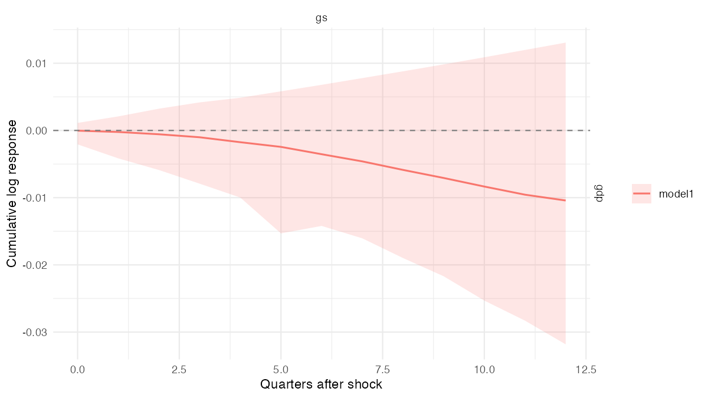
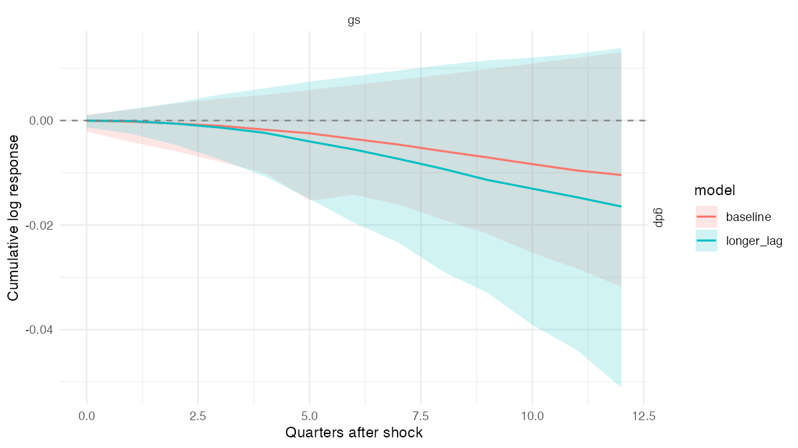
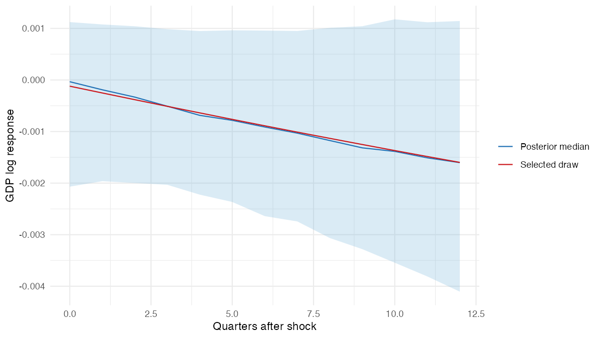

```{r formatting, include=FALSE, purl=FALSE}
knitr::opts_chunk$set(collapse = TRUE, comment = "#>")
```

This article follows one fiscal analysis from posterior draws to an exported
comparison table. It assumes familiarity with R and structural VARs. The demo
models use **bsvars** default identification; economic shock interpretations
must follow the restrictions used in your own model.

## Load the demonstration models

```{r load-fiscal}
library(bsvarPost)
post <- readRDS(system.file("extdata", "fiscal_post_bsvar.rds",
  package = "bsvarPost", mustWork = TRUE))
post_alt <- readRDS(system.file("extdata", "fiscal_post_bsvar_alt.rds",
  package = "bsvarPost", mustWork = TRUE))
metadata <- read.csv(system.file("extdata", "demo-metadata.csv",
  package = "bsvarPost", mustWork = TRUE))
metadata[1:2, c("file", "p", "seed", "draws", "sample_start", "sample_end")]
```

The baseline has one lag and the alternative three. Both contain 200 retained
draws, a small demonstration sample rather than evidence of sampling adequacy.
The installed metadata records estimation software versions, transformations,
sample ranges and checksums. The frozen input data travel with these fits.
Results obtained by re-estimating may differ across software versions.

## GDP's response to government spending

```{r summarize-irf}
responses <- tidy_irf(post, horizon = 12, probability = 0.90)
gdp_irf <- subset(responses, variable == "gdp" & shock == "gs")
gdp_irf[gdp_irf$horizon %in% c(0, 4, 8, 12),
  c("horizon", "median", "lower", "upper")]
```

Horizon zero is impact; horizon 12 is twelve quarters later, giving thirteen
reported horizons. Bounds are pointwise 90% equal-tailed credible intervals,
not a simultaneous band over the entire path. The response is in the data's
log units under the fitted structural-shock normalization. It is not
implicitly normalized to a one-dollar or one-percent spending increase.

## Cumulative responses and units

For draw \(s\), the cumulative response through horizon \(H\) is

\[
C^{(s)}_{ij}(H) = \sum_{h=0}^{H} IRF^{(s)}_{ij}(h).
\]

Summation happens within each draw, before posterior summaries are computed.
The cumulative posterior median need not equal the sum of marginal medians.

```{r summarize-cdm}
cumulative <- tidy_cdm(post, horizon = 12, probability = 0.90)
gdp_cdm <- subset(cumulative, variable == "gdp" & shock == "gs")
gdp_cdm[gdp_cdm$horizon %in% c(0, 4, 8, 12),
  c("horizon", "median", "lower", "upper", "scale_by", "scale_factor")]
```

These inputs are log real per capita levels, without multiplication by 100.
For example, an IRF of `0.001` log units is approximately a 0.1% change
(exactly `100 * (exp(0.001) - 1)` percent). For one hypothetical draw with
responses `0.001`, `0.002`, and `0.001`, the cumulative response at horizon 2
is `0.004` log units summed across three quarters. This is not the endpoint
percentage change or a dollar-per-dollar fiscal multiplier.

```{r units-example}
example_irf <- c(0.001, 0.002, 0.001)
c(impact_percent = 100 * expm1(example_irf[1]),
  cumulative_log_response = sum(example_irf))
scaled <- tidy_cdm(post, horizon = 12, probability = 0.90,
  scale_by = "shock_sd", scale_var = "gs")
subset(scaled, variable == "gdp" & shock == "gs" & horizon == 12,
  select = c(median, scale_by, scale_var, scale_factor))
```

`shock_sd` divides each cumulative response by the reported sample standard
deviation of the selected observed variable (`gs` here). It does not set the
shock's impact spending response to one. A fiscal multiplier requires the
output and spending responses expressed in compatible levels and their
appropriate cumulative ratio. The package does not infer that conversion
from these log series. See `?cdm` and `?posterior_provenance` in R.

```{r fig-cdm}
figure <- ggplot2::autoplot(gdp_cdm) +
  ggplot2::labs(x = "Quarters after shock", y = "Cumulative log response")
```

```{r show-cdm, echo=FALSE, purl=FALSE, out.width="100%", fig.cap="GDP response to the gs shock, summed from impact through each horizon. Line: posterior median; ribbon: pointwise 90% equal-tailed interval. Original log units; no additional scaling.", fig.alt="GDP cumulative response to government spending over horizons zero to twelve"}

```

## Compare lag specifications

```{r compare-cdm}
comparison <- compare_cdm(baseline = post, longer_lag = post_alt,
  horizon = 12, probability = 0.90)
comparison_gdp <- subset(comparison, variable == "gdp" & shock == "gs")
comparison_gdp[comparison_gdp$horizon %in% c(0, 4, 8, 12),
  c("model", "horizon", "median", "lower", "upper")]
```

The names identify models in tables and legends. This is a sensitivity
comparison, not a model-selection criterion or a posterior probability that
one model's response exceeds the other's.

```{r fig-compare-cdm}
figure <- ggplot2::autoplot(comparison_gdp) +
  ggplot2::labs(x = "Quarters after shock", y = "Cumulative log response")
```

```{r show-compare-cdm, echo=FALSE, purl=FALSE, out.width="100%", fig.cap="GDP cumulative response to gs: baseline p=1 and longer_lag p=3. Lines and ribbons show medians and pointwise 90% equal-tailed intervals in original log units, without additional scaling.", fig.alt="Cumulative GDP response under one-lag and three-lag specifications"}

```

## Select one representative draw

A path of marginal medians need not correspond to a single retained structural
model. Select one draw closest to the GDP response's median target over 0–12:

```{r representative}
representative <- median_target_irf(post, horizon = 12, probability = 0.90,
  variables = "gdp", shocks = "gs", horizons = 0:12)
representative$draw_index
representative_path <- subset(summary(representative),
  variable == "gdp" & shock == "gs")
representative_path[representative_path$horizon %in% c(0, 4, 8, 12),
  c("horizon", "median", "draw_index", "selected_draw_id", "method")]
```

Here `median` is the selected draw's response, not the posterior median.
The selected draw provides a coherent model, not an uncertainty interval.
The representative object retains the full array, so explicitly filter the
plot to match the selected target:

```{r fig-representative}
figure <- ggplot2::ggplot(gdp_irf, ggplot2::aes(horizon, median)) +
  ggplot2::geom_ribbon(ggplot2::aes(ymin = lower, ymax = upper),
    fill = "#6baed6", alpha = 0.25) +
  ggplot2::geom_line(ggplot2::aes(colour = "Posterior median")) +
  ggplot2::geom_line(data = representative_path,
    ggplot2::aes(colour = "Selected draw")) +
  ggplot2::scale_colour_manual(values = c("Posterior median" = "#2171b5",
    "Selected draw" = "#cb181d")) +
  ggplot2::labs(x = "Quarters after shock", y = "GDP log response", colour = NULL) +
  ggplot2::theme_minimal()
```

```{r show-representative, echo=FALSE, purl=FALSE, out.width="100%", fig.cap="GDP IRF to gs in original log units. Red: one draw selected over this response at horizons 0–12. Blue: posterior median; ribbon: pointwise 90% equal-tailed interval. No additional scaling.", fig.alt="Selected GDP response draw compared with the posterior median and interval"}

```

## Export results with provenance

```{r export-results}
as_kable(comparison_gdp, preset = "compact", digits = 3,
  caption = "GDP cumulative response to government spending")
output <- tempfile(fileext = ".csv")
write_bsvar_csv(comparison_gdp, file = output)
exported <- read.csv(output, check.names = FALSE)
exported[1:2, c("Model", "Horizon", "Median", "Interval probability",
  "Interval method", "Scaling", "Source package", "Source version", "Draw count")]
```

Replace `output` with your chosen path to keep the file. The default export
retains provenance with readable column labels; the compact table is for presentation. `source_version`
identifies software used for the current calculation; estimation history is
in the demo metadata. Economic `units` can be unknown because arbitrary
transformations cannot be reconstructed from a posterior object.

For scripts that require fixed column names, select a schema explicitly and
use the standard CSV writer:

```{r export-fixed-schema}
schema <- c("model", "variable", "shock", "horizon", "median", "lower", "upper",
  "interval_probability", "interval_method", "scale_by", "scale_factor",
  "source_package", "source_version", "n_draws")
machine_output <- tempfile(fileext = ".csv")
write.csv(as.data.frame(comparison_gdp)[, schema], machine_output, row.names = FALSE)
```

## Supported plotting inputs

`ggplot2::autoplot()` handles response summaries and supported draw-level paths;
`publish_bsvar_plot()` adds publication styling for supported families.
Individual timing summaries and draw-level hypothesis or event tables do not
have an automatic plot. Summarize first or use a suitable comparison/family
plot; passing unsupported inputs raises an explicit error.

```{r supported-plots}
probabilities <- hypothesis_irf(post, variables = "gdp", shocks = "gs",
  horizon = 0:12, relation = ">", value = 0)
probability_plot <- plot_hypothesis(probabilities)
```

For grouped historical decompositions, consult the
[draw-level input recipe](historical-decomposition-events.html#grouped-and-summary-inputs).

## Estimate your own models

This optional recipe uses the same frozen input, seeds and 200-draw settings
as the demo generator. For research, choose an appropriate model, sampling
length and diagnostic strategy; 200 draws is only an illustration.

<!-- documentation-skip: estimation -->
```{r estimate-fiscal, eval=FALSE}
fiscal_data <- readRDS(system.file("extdata", "us_fiscal_lsuw.rds",
  package = "bsvarPost", mustWork = TRUE))
set.seed(123)
spec <- bsvars::specify_bsvar$new(fiscal_data, p = 1)
post <- bsvars::estimate(spec, S = 200, thin = 1, show_progress = FALSE)
set.seed(456)
spec_alt <- bsvars::specify_bsvar$new(fiscal_data, p = 3)
post_alt <- bsvars::estimate(spec_alt, S = 200, thin = 1, show_progress = FALSE)
```

For other posterior quantities use `tidy_fevd()`, `tidy_shocks()`,
`tidy_forecast()` and `tidy_hd()`. Continue with
[inference and comparison](inference-and-comparison.html),
[historical decompositions](historical-decomposition-events.html), or
[sign-restricted workflows](sign-restricted-workflows.html).
The [reference index](https://davidzenz.github.io/bsvarPost/reference/index.html)
and `help(package = "bsvarPost")` document supported inputs.
