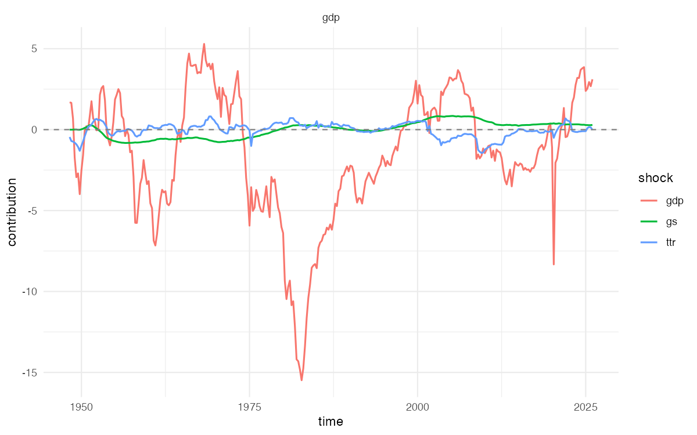
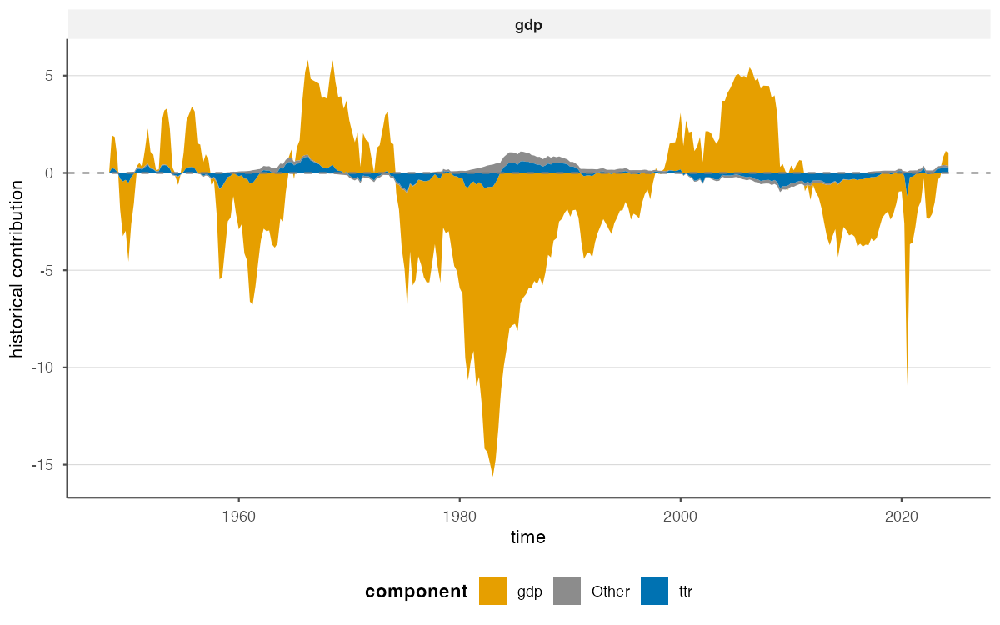

```{r formatting, include=FALSE, purl=FALSE}
knitr::opts_chunk$set(collapse = TRUE, comment = "#>")
```

## Load the demonstration models

These fits contain 200 retained draws each, for illustration rather than
sampling-adequacy claims. Use `?posterior_provenance` for column definitions;
use `help(package = "bsvarPost")` for offline function documentation.

```{r load-fiscal}
library(bsvarPost)
post <- readRDS(system.file("extdata", "fiscal_post_bsvar.rds",
  package = "bsvarPost", mustWork = TRUE))
post_alt <- readRDS(system.file("extdata", "fiscal_post_bsvar_alt.rds",
  package = "bsvarPost", mustWork = TRUE))
```

Historical decompositions from **bsvars** and **bsvarSIGNs** attribute the
observed values of each variable to structural shocks at each point in time.
**bsvarPost** aggregates these contributions over selected periods, ranks the
contributions of individual shocks, and compares results across model
specifications.

The analysis accepts a posterior model, a `PosteriorHD` object, or a draw-level
table of historical decompositions. Economically meaningful shock labels should
reflect the identification of the model. The documentation of **bsvars** and
**bsvarSIGNs** describes estimation and computation of historical
decompositions. The examples below use stored posterior draws to reproduce the
reported results without re-estimating the models.

## Posterior draws

Whenever a plot combines multiple shocks, including a collapsed `"Other"`
category, it also needs posterior draws. Marginal medians and interval bounds
cannot be added to obtain a grouped posterior summary. Summary-table input
remains supported for ungrouped displays and one-to-one shock renaming.

The non-shock baseline is computed from all shock contributions before display
filtering. A decomposition total is summarized after summing its draws; displayed
marginal component medians need not add up to the median total.

Event-specific analysis requires posterior draws of historical decompositions,
not only pointwise posterior summaries. For a short event, pass the posterior directly to `tidy_hd_event()` so that
aggregation can select the window before constructing a long table. Full-sample
draw tables are useful when you need several custom aggregations. Obtain them with
[`tidy_hd(draws = TRUE)`](https://davidzenz.github.io/bsvarPost/reference/tidy_hd.html):

```{r hd-draws}
hd_draws <- tidy_hd(post, draws = TRUE)

data.frame(
  first = head(unique(as.character(hd_draws$time)), 1),
  last = tail(unique(as.character(hd_draws$time)), 1),
  draws = length(unique(hd_draws$draw))
)
```

Each row identifies the model, variable, shock, observation, and posterior
draw. Aggregation is performed separately for every draw. Posterior summaries
therefore account for uncertainty in the contribution accumulated over the
entire event period.

The full-sample historical decomposition provides the context for the event
analysis. The figures show the main shock contributions as separate paths and
as stacked contributions.

```{r fig-hd-overlay}
figure <- plot_hd_overlay(post, variables = "gdp", top_n = 3,
  probability = 0.90)
```

```{r hd-overlay-figure, fig.cap="Full-sample GDP shock contributions in log units. Lines show marginal posterior medians; baseline, observed series and uncertainty ribbons are omitted. Component medians need not add to the median total.", echo = FALSE, purl=FALSE, out.width = "100%", fig.alt = "Structural-shock contributions to GDP over the full sample"}

```

```{r fig-hd-full}
figure <- plot_hd_stacked(post, variables = "gdp", top_n = 2,
  probability = 0.90)
```

```{r hd-composition-figure, fig.cap="Full-sample GDP decomposition in log levels, retaining two contributors and combining the remainder into Other within each draw. Stacks show marginal medians, not an exact additive decomposition of posterior medians.", echo = FALSE, purl=FALSE, out.width = "100%", fig.alt = "Stacked structural-shock contributions to GDP over the full sample"}

```

## Grouped and summary inputs

Grouping must sum each draw before computing its interval. This recipe combines
spending and taxes into a fiscal group, leaving the remaining shock in Other.
A draw table contains shock contributions only, so disable the observed series
and non-shock baseline; pass `post` instead to recover those components:

```{r grouped-hd}
grouped_plot <- plot_hd_overlay(hd_draws, variables = "gdp", intervals = TRUE,
  shock_groups = c(gs = "Fiscal", ttr = "Fiscal"),
  collapse_other = TRUE, probability = 0.90,
  include_observed = FALSE, include_baseline = FALSE)
```

For ungrouped lines a summary is sufficient:

```{r summary-hd}
hd_summary <- tidy_hd(post, probability = 0.90)
summary_plot <- plot_hd_lines(hd_summary, variables = "gdp")
```

Passing `hd_summary` to an overlay that merges shocks, including `top_n` with
Other, raises a draw-level-input error. Use `post`, a `PosteriorHD` array, or
`tidy_hd(post, draws = TRUE)` instead. `plot_hd_stacked()` reconstructs a full
decomposition internally and requires a posterior model, even when the baseline
is hidden. Plots requesting an observed series also need the posterior model.

## Event periods

The empirical question determines the event period. It should not be selected
from the estimated ranking of shocks. The analysis should therefore:

1. define the dates from the research question or an external chronology;
2. match `start` and `end` to the time labels and frequency of the data; and
3. assess sensitivity to reasonable neighbouring periods while retaining the
   prespecified result.

The example uses the four quarters from `1958` to `1958.75`, which are present
in both stored posterior samples. No particular historical interpretation is
assigned to this period. Each sample contains 200 posterior draws. The economic
interpretation of every shock follows from the identifying restrictions of the
fitted model.

```{r event-window}
event_start <- "1958"
event_end <- "1958.75"

event <- tidy_hd_event(
  post,
  start = event_start,
  end = event_end,
  probability = 0.90
)

subset(
  event,
  variable == "gdp",
  select = c(variable, shock, event_start, event_end,
             median, lower, upper)
)
```

[`tidy_hd_event()`](https://davidzenz.github.io/bsvarPost/reference/tidy_hd_event.html) sums the contribution of
each shock over the inclusive period for every posterior draw and then reports
posterior summaries. Set `draws = TRUE` to retain the aggregated draws for
subsequent calculations.

The largest posterior median does not establish that a shock was the dominant
historical source of variation. Credible intervals describe posterior
uncertainty about the aggregated contribution, while the economic meaning of
the shock remains determined by the identification of the model.

## Shock rankings

[`shock_ranking()`](https://davidzenz.github.io/bsvarPost/reference/shock_ranking.html) ranks shocks within each
model and variable. The example reports results for `gdp`.

```{r rank-shocks}
ranking <- shock_ranking(
  post,
  start = event_start,
  end = event_end,
  variables = "gdp",
  ranking = "absolute",
  probability = 0.90
)

ranking[, c("variable", "shock", "median", "lower", "upper", "rank")]
```

With `ranking = "absolute"`, shocks are ordered by the absolute posterior
median of their contribution. Use `ranking = "signed"` when the sign is part of
the estimand. In both cases, `rank` is based on posterior medians. Overlapping
credible intervals indicate uncertainty that is not represented by this
ordering.

The plot reports the sign and magnitude of each contribution and orders the
bars by the absolute posterior median.

```{r ranking-plot}
ranking_plot <- publish_bsvar_plot(
  ranking,
  family = "shock_ranking",
  preset = "paper",
  title = "GDP contributions during the selected window",
  caption = "Bars are posterior medians; uncertainty remains in the event table."
)
ranking_plot
```

To plot contributions without ranking, use
[`plot_hd_event()`](https://davidzenz.github.io/bsvarPost/reference/plot_hd_event.html). The more specialized
[`plot_hd_event_share()`](https://davidzenz.github.io/bsvarPost/reference/plot_hd_event_share.html),
[`plot_hd_event_cumulative()`](https://davidzenz.github.io/bsvarPost/reference/plot_hd_event_cumulative.html), and
[`plot_hd_event_distribution()`](https://davidzenz.github.io/bsvarPost/reference/plot_hd_event_distribution.html)
show the composition of contributions, their accumulation within the selected
period, and their posterior distributions, respectively.

## Comparison across model specifications

Comparisons of lag orders or prior distributions require the same event period
for every model. [`compare_hd_event()`](https://davidzenz.github.io/bsvarPost/reference/compare_hd_event.html)
applies the selected period to named posterior objects and indexes the results
by model specification.

```{r compare-event}
event_comparison <- compare_hd_event(
  baseline = post,
  alternative = post_alt,
  start = event_start,
  end = event_end,
  probability = 0.90
)

comparison_gdp <- subset(
  event_comparison,
  variable == "gdp",
  select = c(model, shock, event_start, event_end,
             median, lower, upper)
)
comparison_gdp
```

The comparison is descriptive. Similar posterior summaries across
specifications provide evidence of robustness to the considered changes, but
`compare_hd_event()` neither selects a model nor computes the posterior
probability of a difference between specifications. Names such as `baseline`
and `alternative` identify the specifications in tables and plots.

## Tables and figures

Posterior summaries can be reported in a labelled table, while the ranking plot
can be saved separately. Both outputs are standard R objects and can be
formatted for the intended application.

```{r publication-table}
as_kable(
  comparison_gdp,
  caption = "GDP shock contributions in the selected event window",
  digits = 2,
  preset = "compact"
)
```

```{r save-plot}
ggplot2::ggsave(
  tempfile(fileext = ".pdf"),
  ranking_plot,
  width = 7,
  height = 4
)
```

For posterior summaries, response comparisons, and posterior probability
statements, see [Post-estimation Analysis with bsvarPost](bsvarPost.html).
Diagnostics for sign-restricted identification are presented in the dedicated
**bsvarSIGNs** article.
